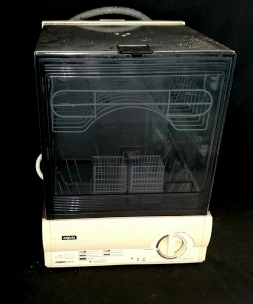
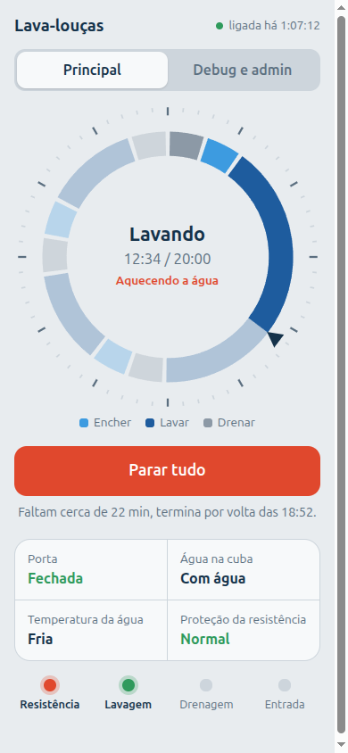
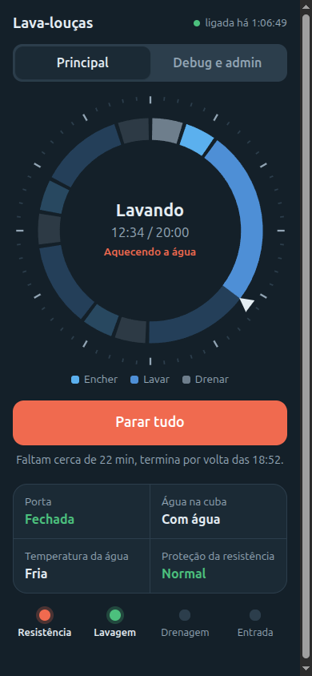
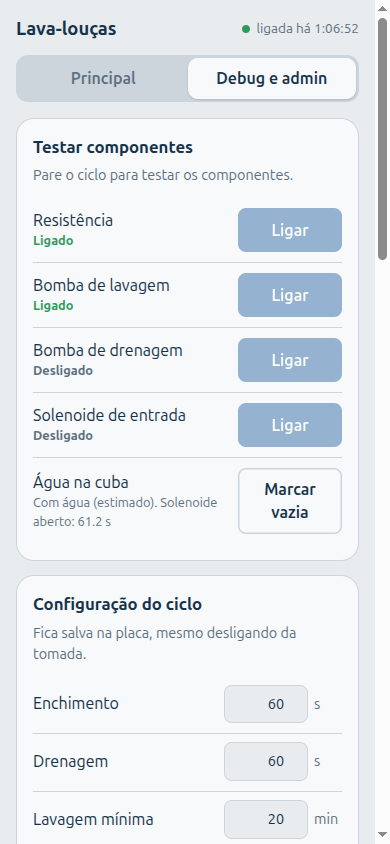
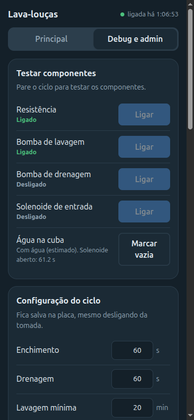
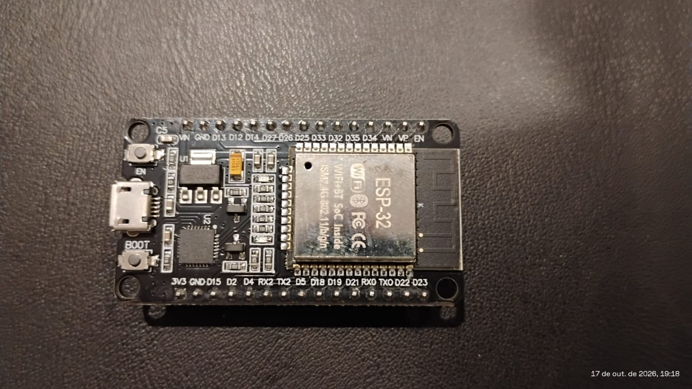
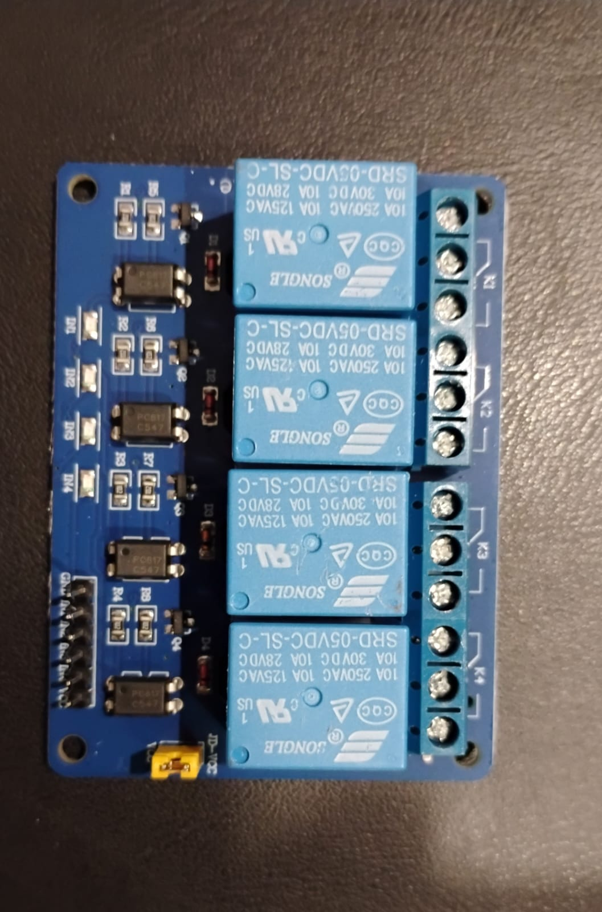

# Lava-louças 110 V com ESP32



Esta é a nossa **Enxuta Master Power**. Ela já viu mais louça do que muito restaurante, o painel bege entrega a idade, e o timer de engrenagens já cumpriu a missão dele.

Comprar uma nova? Já viu o preço de uma lava-louças hoje? Pois é. E lavar louça na mão está fora de cogitação: em casa **ninguém** quer voltar para a pia. Então a solução foi a mais lógica possível: dar um cérebro novo para a velhinha.

O timer redondo saiu e no lugar entrou uma **ESP32 com um módulo de 4 relés**. Agora ela é controlada pelo **celular**, numa página web que a própria placa serve, sem internet e sem aplicativo. Ela continua velha, mas agora tem Wi-Fi. 😎

<br clear="right">

O timer antigo virou um dial na tela:

| Modo claro | Modo escuro |
|---|---|
|  |  |
|  |  |

## As placas

| ESP32 DevKit V1 (30 pinos) | Módulo de 4 relés 5 V |
|---|---|
|  |  |

A **ESP32** roda o firmware e cria a rede Wi-Fi. O **módulo de 4 relés 5 V** (com optoacoplador, liga com LOW) aciona as cargas de 110 V. A ligação entre as duas (pinos e alimentação) está no [`LIGACAO.md`](LIGACAO.md).

## Como funciona

A placa liga e desliga 4 cargas e lê 3 sensores:

| Liga e desliga (relés) | Lê (sensores) |
|---|---|
| Resistência (esquenta a água) | Porta fechada ou aberta |
| Bomba de lavagem (joga água nas louças) | Termostato da cuba: a água chegou na temperatura? |
| Bomba de drenagem (tira a água) | Klixon: a resistência superaqueceu? |
| Solenoide de entrada (deixa a água entrar) | |

Ainda não tem bóia, então o nível de água é controlado **pelo tempo** que o solenoide fica aberto.

**O ciclo:** drena o que sobrou, enche, lava com água quente, drena e faz os enxágues. Tudo aparece num dial redondo, no lugar do timer antigo.

**Segurança vem antes de tudo:**
- porta aberta desliga tudo na hora;
- a resistência só liga com água que entrou pelo solenoide e com a água ainda fria. Marcar "com água" na página não basta;
- encher e drenar nunca acontecem juntos;
- se o Klixon disparar, a máquina para e só volta quando você liberar;
- só a página da própria placa consegue mandar comandos. Um site qualquer aberto no celular não consegue ligar nada.

**A página tem duas abas:**
- **Principal:** o dia a dia. Mostra o dial, o botão iniciar/parar, os sensores e o tempo que falta.
- **Debug e admin:** testar cada componente, ajustar os tempos do ciclo, ver as leituras cruas, as informações da placa e o registro de eventos.

## Andamento

Testes de bancada feitos até agora, sem 110 V:

| Teste | Situação |
|---|---|
| Sensores: porta, termostato da cuba, Klixon (falha e liberação) | ✅ |
| Wi-Fi da casa com IP fixo reservado no roteador | ✅ |
| Módulo de relés alimentado pelo `VIN` (5 V), com o jumper | ✅ |
| Os 4 relés nos pinos definitivos | ✅ |
| Resistência bloqueada sem água e com a água quente | ✅ |
| Porta aberta desliga e bloqueia tudo | ✅ |
| Página recusa comandos vindos de outros sites | ✅ |
| Resistência bloqueada com a água só marcada à mão | ⏳ |
| Encher e drenar nunca juntos | ⏳ |
| Sensores de verdade na máquina | ⏳ |
| Testes com 110 V, calibrar o enchimento, ciclo completo | ⏳ |

A ordem dos próximos testes está no [`LIGACAO.md`](LIGACAO.md), item 7.

## Como gravar

1. Copie `LavaLoucas/secrets.example.h` para `LavaLoucas/secrets.h` e coloque a senha da rede da placa (`AP_PASS`, mínimo 8 caracteres). Se quiser, preencha também a sua rede de casa (`WIFI_SSID` e `WIFI_PASS`). O `secrets.h` não vai para o git.
2. Compile e grave pelo terminal com o [`arduino-cli`](https://arduino.github.io/arduino-cli/), com o core `esp32:esp32` instalado (URL da placa: `https://espressif.github.io/arduino-esp32/package_esp32_index.json`):
   ```bash
   arduino-cli compile --fqbn esp32:esp32:esp32 --build-path build LavaLoucas
   arduino-cli upload  -p /dev/ttyUSB0 --fqbn esp32:esp32:esp32 --input-dir build
   ```
   Se preferir, use a Arduino IDE: abra `LavaLoucas/LavaLoucas.ino`, escolha a placa **ESP32 Dev Module** e grave. Grave com a máquina fora da tomada.
3. No celular, entre na rede Wi-Fi **LavaLoucas** e abra **http://192.168.4.1**. Se configurou a rede de casa, use o IP que a placa pegou (aparece no registro da página e na serial) ou **http://lavaloucas.local**, que só funciona para quem está na mesma rede da placa. Dica: reserve um IP fixo para a placa no roteador.

**Se a placa reiniciar sozinha** (a página ora responde, ora trava), o problema costuma ser a alimentação: cabo ou porta USB com mau contato. Veja o item 3 do [`LIGACAO.md`](LIGACAO.md).

> ⚠️ **Perigo: 110 V, água e uma resistência de ~1000 W.** Há risco real de choque elétrico e de incêndio.
> - **Antes de ligar na tomada, leia o [`LIGACAO.md`](LIGACAO.md)**: esquema elétrico, aterramento, proteções físicas e a ordem de testes.
> - Nunca mexa na fiação nem grave o firmware com a máquina na tomada.
> - O firmware desliga tudo em caso de porta aberta ou sobretemperatura, mas software pode falhar: as proteções físicas (termostato de segurança, aterramento, DR) são obrigatórias.
> - Faça por sua conta e risco.

## Onde está cada coisa

```
LavaLoucas/
├── LavaLoucas.ino        setup() e loop(): o roteiro principal
├── config.h              pinos e ajustes de hardware
├── secrets.h             senhas (só na sua máquina)
└── src/
    ├── hardware/         sensores e relés
    ├── control/          ciclo, travas de segurança e água
    ├── storage/          configuração salva e registro de eventos
    └── web/              Wi-Fi, API e a página
docs/                     fotos da máquina e das placas, prints da página
scripts/intellisense.sh   autocomplete do VS Code
```

Para usar o VS Code: instale a extensão C/C++ e rode `./scripts/intellisense.sh` depois de instalar o `arduino-cli`.
